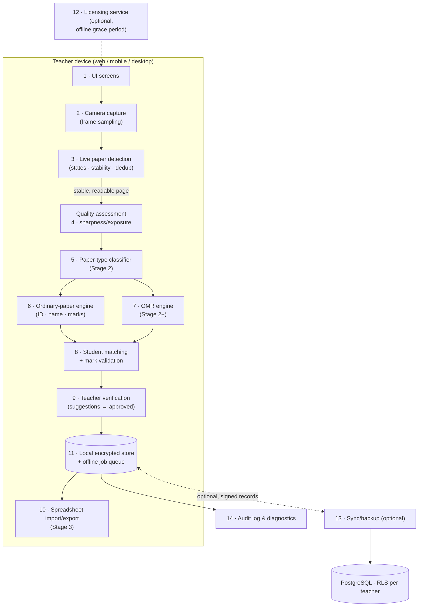

# Stage 1 — High-Level Architecture
**AI Mark Entry System**

## 1. Stack decision (candidates evaluated against the existing repo)

| Layer | Candidate | Decision for this repo | Rationale |
|---|---|---|---|
| Mobile app | React Native + Expo (TypeScript) | **Already exists — keep** | Working offline-first app with encryption, sync, i18n ×5 |
| Web app | React (TypeScript) | Shared logic with RN via the Expo web target | One codebase covers browsers today |
| Desktop | Tauri or Electron | **Deferred (Stage 3+)** | Web build + PWA covers pilots; native packaging waits for demand. Tauri (Rust, GPLv3/commercial) preferred over Electron (heavy) if needed — license review required then |
| Vision service | Python + FastAPI | **Already exists — keep** | `vision-service/` runs OpenCV today, auth-gated, load-shedding in place |
| OCR | PaddleOCR / Tesseract | **Tesseract now** (Apache-2.0), PaddleOCR (Apache-2.0) evaluated Stage 2 | Tesseract is already integrated & license-safe; PaddleOCR offers better handwriting accuracy but heavier runtime — bench both in Stage 2 |
| Image processing | OpenCV | **In use** | Proven in this repo (Otsu, Laplacian, contours) |
| Task models | ONNX Runtime-hosted small models | Stage 2 research (see recognition plan) | ONNX Runtime is MIT-licensed and cross-platform |
| Local data | SQLite (desktop) / AsyncStorage+encryption (mobile) | Mobile AsyncStorage **already encrypted in-app** | Same data model either way |
| Optional cloud | PostgreSQL (Supabase) | **In use, optional** | RLS-scoped per teacher; the app is fully functional offline |

Rule honored: **no platform is forced into an unsuitable shape.** Mobile keeps its native
paths; the desktop path reuses the web UI; the vision engine is a shared HTTP contract
(`vision-schema.ts`), so engines can be swapped without touching UI code.

## 2. Component map (the 14 logical components)

Stage 1 components marked ✅ exist now; ◐ partially exist; ✗ later stage.

| # | Component | Status | Where it lives |
|---|---|---|---|
| 1 | User interface | ✅ | `expo/app/*` screens (React Native/Expo) |
| 2 | Camera capture & frame handling | ◐ | `expo/components/live-camera.tsx` (web live stream), system camera on native; PoC `main.py` for desktop/webcam |
| 3 | Live paper detection | ✅ (PoC) | `proof-of-concept/live-paper-detection/` — states, stability, duplicate suppression |
| 4 | Image correction & quality assessment | ✅ | `vision-service/vision_engine.py` (Otsu, Laplacian, luminance) |
| 5 | Paper-type classification | ✗ | Stage 2 (ordinary vs OMR template match) |
| 6 | Ordinary-paper recognition engine | ◐ | `vision-service/` label-anchored OCR (ID/name/marks), confidence-gated |
| 7 | OMR recognition engine | ✗ | Stage 2+ (separate pipeline, recognition plan §3) |
| 8 | Student matching & mark validation | ✅ | roster matching + confidence floors in `expo/lib/*` |
| 9 | Teacher verification & approval | ✅ | review screens; suggestions ≠ approved records |
| 10 | Spreadsheet import/mapping/export | ✗ | Stage 3 |
| 11 | Local database & offline job queue | ✅ | encrypted AsyncStorage store + sync queue |
| 12 | Optional account/licensing services | ◐ | Supabase auth exists; licensing is specified (`STAGE_1_LICENSING.md`), not built |
| 13 | Optional sync/backup services | ◐ | record sync exists; backup/restore is Stage 3+ |
| 14 | Audit logging & diagnostics | ✅ | version history per record; client event journal (`observability.ts`) |

## 3. Architecture diagram

## 4. Data flow in plain language

The camera streams frames; the app **samples** them at ~5 fps and runs cheap classical CV
(contour/Otsu) to decide whether a page is present, stable, and readable — expensive
recognition never runs per video frame. When the detector reports READY, one captured
frame goes to quality assessment, then to the recognition engine for the classified paper
type. Recognition returns *suggestions with confidence*; anything below the confidence
floor is routed to manual entry. The teacher approves, corrects, or rejects each
suggestion; approved records are signed (HMAC) and stored encrypted locally, then pushed
to the optional cloud when online. Exports read only approved records.

## 5. API contract between app and vision engine (already implemented)

Single strict JSON frame: `paper_detected`, `metadata{read_quality,
inference_latency_ms_estimate, paper_bounds}`, `student_identifiers{extracted_id,
extracted_name}`, `grading_metrics{detected_marks_count, confidence_score}` — minified,
single line, identical for both engines, defined in `expo/lib/vision-schema.ts`.
`detected_marks_count` is a raw mathematical count; the engine never grades.
